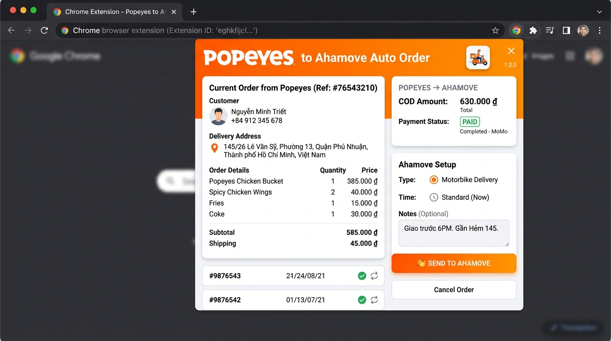

# 🍗 Popeyes → Ahamove Auto Order (Chrome Extension)

> **Chrome Extension Manifest V3** tự động hóa quy trình trích xuất thông tin đơn hàng từ hệ thống quản lý POS Popeyes và tự động điền form tạo đơn vận chuyển trên Ahamove.



---

## 📌 Bối cảnh & Vấn đề giải quyết

Trong giờ cao điểm vận hành tại chuỗi cửa hàng Popeyes Vietnam, nhân viên phải thủ công sao chép từng thông tin đơn hàng (Tên khách hàng, Số điện thoại, Địa chỉ nhận hàng, Giá trị đơn hàng COD) từ phần mềm quản lý BeeIQ (`popeyes.beeiq.co`) sang cổng tạo đơn vận chuyển Ahamove (`app.ahamove.com`).

* **Hạn chế cũ**: Mất 1 - 2 phút cho mỗi đơn hàng, dễ phát sinh sai sót chính tả địa chỉ hoặc sai lệch số tiền thu hộ (COD) trong giờ cao điểm.
* **Giải pháp**: Extension giúp tự động quét dữ liệu bằng DOM Scraping, xác thực & cho phép chỉnh sửa nhanh qua giao diện popup, sau đó tự động mở Ahamove và tự động điền (autofill) toàn bộ trường thông tin chỉ với 1 cú click chuột.

---

## ✨ Tính năng chính

1. **Smart DOM Scraping**: Tự động nhận diện cấu trúc đơn hàng trên hệ thống BeeIQ POS (`Tên người nhận`, `Số điện thoại`, `Địa chỉ`, `Trị giá COD`).
2. **Interactive Popup UI**:
   - Hiển thị trực quan thông tin đã đọc.
   - Cho phép nhân viên kiểm tra và chỉnh sửa nhanh thông tin nếu cần trước khi điều phối.
   - Chọn trạng thái thanh toán linh hoạt: **Đã thanh toán (COD = 0)** hoặc **Chưa thanh toán (Thu hộ đúng giá trị đơn)**.
3. **Automated Cross-Tab Navigation**:
   - Tự động lưu trữ payload vào `chrome.storage.local`.
   - Điều hướng hoặc mở tab mới đến `app.ahamove.com`.
4. **Mantine UI DOM Injection**:
   - Giải quyết thách thức điền dữ liệu vào các component React / Mantine UI phức tạp trên Ahamove bằng mô phỏng sự kiện bàn phím và con trỏ (`execCommand`, `dispatchEvent`, giả lập tương tác người dùng).
   - Tự động điền điểm giao hàng, thông tin người nhận, tiền thu hộ và ghi chú tài xế.

---

## 🛠️ Công nghệ sử dụng

* **Nền tảng**: Google Chrome Extension (Manifest V3)
* **Ngôn ngữ**: Vanilla JavaScript (ES6+), HTML5, CSS3
* **APIs**: Chrome Scripting API, Chrome Tabs API, Chrome Storage API, Chrome Runtime Messaging
* **Kỹ thuật**: DOM Automation, React/Mantine Synthetic Events simulation, XPath & QuerySelectors

---

## 🚀 Hướng dẫn cài đặt & sử dụng

1. **Tải mã nguồn**:
   ```bash
   git clone https://github.com/tnkietit/popeyes-ahamove-extension.git
   ```
2. **Cài đặt vào trình duyệt**:
   - Mở Chrome và truy cập đường dẫn: `chrome://extensions/`
   - Bật chế độ **Developer mode** (Chế độ dành cho nhà phát triển) ở góc trên bên phải.
   - Nhấn **Load unpacked** (Tải tiện ích đã giải nén) và chọn thư mục `popeyes-ahamove-extension`.
3. **Sử dụng**:
   - Mở đơn hàng trên hệ thống `popeyes.beeiq.co`.
   - Nhấn vào biểu tượng Extension trên thanh công cụ duyệt web.
   - Nhấn **"Quét thông tin đơn hàng"** $\rightarrow$ Kiểm tra thông tin $\rightarrow$ Chọn trạng thái thanh toán.
   - Nhấn **"Gửi sang Ahamove"** để hoàn tất tự động.

---

## 👤 Tác giả

* **Phạm Tuấn Kiệt (Kelvin)**
* GitHub: [@tnkietit](https://github.com/tnkietit)
* Portfolio: [tnkietit/front-end-intern-portfolio](https://github.com/tnkietit/front-end-intern-portfolio)
